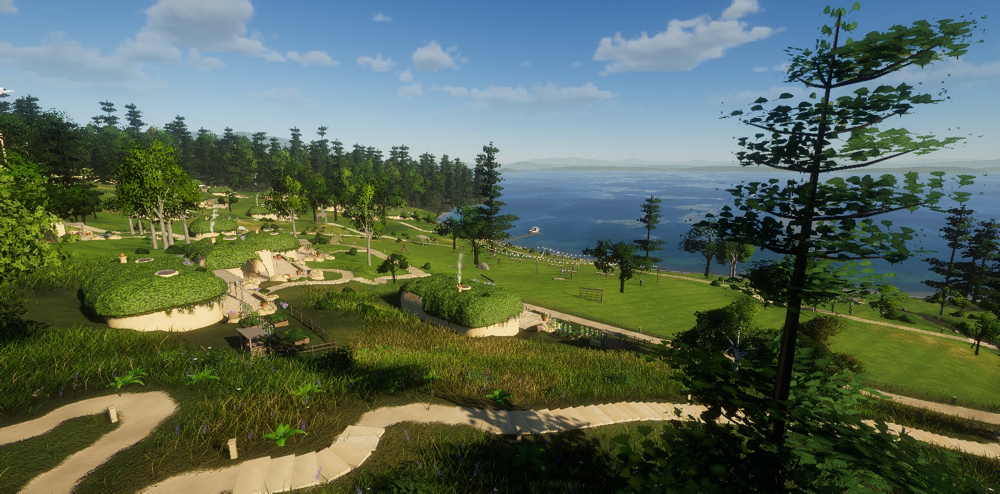
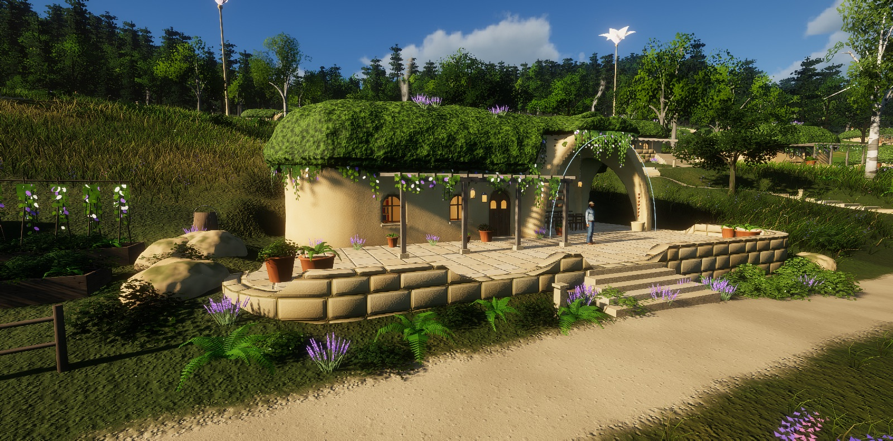
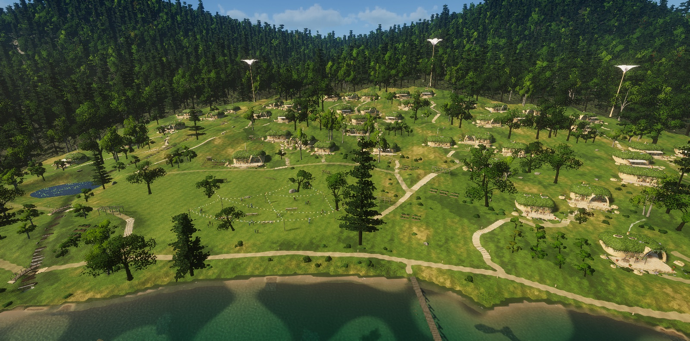

# Understory

A village of earth-sheltered homes on the north shore of Squam Lake, New Hampshire, to walk through in the
browser: rounded plaster homes under thick planted roofs, in small clusters up the slope of Rattlesnake Mountain, a
festival green hung with lanterns and gardens in the valley, a stream falling through a lily pond into a cove,
and the lake with its islands spread out below. The land is real (USGS lidar); the village is imagined
(see [docs/REFERENCE.md](docs/REFERENCE.md) for the look it works toward and [docs/DECISIONS.md](docs/DECISIONS.md)
for the creative calls made so far).







It is built on [Tidewater](https://github.com/dgreenheck/tidewater) by DRG Software Solutions (MIT): a
real-time WebGPU world with its own small rendering engine (raw WebGPU and WGSL, no framework), whose sky,
water, terrain, vegetation, lighting and post-processing it reuses and adapts.

## Requirements

- A browser with WebGPU: a recent Chrome, Edge or Safari, and a capable GPU.
- The first load compiles several hundred shaders, which can take a minute or more. Later visits are faster
  because the browser caches them.

## What is there

**The land**
- Squam Lake's north shore from the USGS 3DEP lidar: 2 km around the village at 1 m, the lake and its islands
  at 4 m, the Squam Range, Red Hill, the Sandwich Range foothills and Winnipesaukee at 16 m to the horizon.
  The lake's surface is the lidar's hydro-flattened water level; other lakes and ponds keep their own levels.
- A generated lake bed (the lidar does not see under water): shelving from the shore by the land's slope,
  up to ~27 m deep in the open basin, with submerged boulder shoals.
- New Hampshire granite: ledges and talus under Rattlesnake's cliffs, boulder-strewn shores, glacial erratics.

**The village** (`src/world/Settlement.js`, layout as data in `src/world/settlement/Plan.js`)
- 73 homes in terraced rows on two hillsides (and a hamlet across the water), after the author's painting of Mimi's house: long, softly rounded
  plaster bodies under thick planted roofs with an overhanging lip, arched doors and round windows, skylights
  and chimneys; on many a great open arch at one end sheltering an outdoor kitchen (domed oven, long table,
  lanterns); pergolas and awnings, curved block terraces, lavender, sandstone boulders, kitchen gardens; on some
  arches the pale blue seam of everyday technology. Shells are meshed from distance fields at load, in workers.
- People on the festival green and on a few terraces (Tidewater's Rocketbox characters, talking, waving).
- Homes in small clusters round little commons, groves between, and paths winding from one to the next (stone
  stairs where they climb); the green with log play frames and a festival
  ground of oaks, lantern strings and long tables; raised-bed gardens and pergolas, a stream with falls and
  timber footbridges, a lily pond, a dock.

**The woods and meadows**
- Eastern white pines and hemlocks, maples, red oaks, beeches and paper birches, mountain laurel, hobblebush
  and blueberry, ferns on the forest floor.
- In the village, groves of broad open-grown oaks and maples with birches between the homes, meadow grass with
  lupines and daisies, and a mown green.

**The lake**
- Common loons out on the open water, in pairs and alone: swimming, peering, diving and surfacing somewhere
  else, the odd wing-flap; now and then one runs across the water to take off and flies to another bay.

**From Tidewater**
- Physically based sky and atmosphere, volumetric clouds, cascaded shadows, ambient occlusion, temporal
  upscaling, bloom and haze; an FFT water surface (tuned to a lake's short wind chop) with refraction, caustics
  and an underwater view; walking, swimming and a boat with its wake; positional audio.

## Controls

| Key | Action |
|---|---|
| W A S D | Move |
| Mouse | Look (click to capture the mouse, Esc to release) |
| Shift | Run / boat boost |
| Space | Jump / swim up |
| C | Crouch / dive |
| E | Board the boat, take or leave the helm, step ashore |
| V | Boat camera (1st / 3rd person) |
| F | Fly free |
| L | Flashlight |
| T | Let the day run / stop it |
| M | Mute |
| H | Settings panel |
| P | Photo mode |
| F1 or ? | All controls |

## URL options

| Option | Effect |
|---|---|
| `fly` | Start flying |
| `noAudio` | No sound |
| `noClouds` | Skip the volumetric clouds |
| `noHaze` | Skip the haze and sun shafts |
| `noCaustics` | Skip caustics |
| `noVeg` | Skip the plants |
| `noVillage` | The bare land, without the village |
| `noWildlife` | No loons |

## Running locally

```sh
npm install
npm run dev      # http://127.0.0.1:5189
npm run build    # static build in dist/
```

Reference shots of named views (`src/core/DebugViews.js`) from a headless Chrome, with the dev server running:

```sh
node tools/shots/shoot.mjs villageAerial,mimiHero,festival,green,pond --out=shots
```

The terrain in `public/terrain/` is built by `tools/terrain/build_terrain.py` (Python 3 with numpy, scipy and
tifffile; it downloads and caches the USGS 3DEP data).

## Project layout

| Folder | Contents |
|---|---|
| `src/world/settlement/` | The village: plan, earthworks, homes (distance-field shells, `Sdf.js`), festival, landscape (steps, bridges, gardens, dock), its water and vines |
| `src/world/` | Terrain (near, mid and far grids), far terrain, rocks, vegetation, the boat |
| `src/world/vegetation/` | Placement (ForestScatter), conifers, broadleaf trees and shrubs, ferns, the grass field, impostors |
| `src/engine/` | The rendering engine: math, scene graph and geometry, GPU resources, WGSL shader composition, materials, lighting and shadows |
| `src/ocean/` | The water: FFT waves, surface and material, shore waves, wake, caustics, underwater lighting |
| `src/sky/` | Atmosphere, clouds, sky and environment |
| `src/post/` | Post chain: AO, underwater composite, haze, TAAU, motion blur, bloom, lens flare, droplets |
| `src/player/` | Walking, swimming, the boat and the free camera |
| `src/audio/` | The sample-based soundscape |
| `src/ui/` | Settings panel, loading screen and HUD |
| `src/game/` | Tidewater's fishing game (not loaded: Understory has no fishing economy) |
| `tools/` | The terrain build, the shot runner, and Tidewater's asset scripts |
| `docs/` | The visual reference, the decisions log |

## Credits and license

The code is released under the MIT license (see [LICENSE](LICENSE)); it is based on Tidewater, © DRG Software
Solutions LLC, MIT. Elevation data: USGS 3D Elevation Program (public domain). Third-party assets inherited
from Tidewater (CC0 audio from Freesound, CC0 scans from Poly Haven, MIT characters from Microsoft Rocketbox,
OFL / Apache fonts) and technique references are listed in [CREDITS.md](CREDITS.md).
